  

###

<h1 data-importer="text" align="center">Hey there 👋</h1>

###

<h3 data-importer="text" align="left">👩‍💻  About Me</h3>

###

I'm Abdullah Ahmad from Lahore, Pakistan.  - 🔭 I’m working as Software Engineer - 📚 I'm currently learning New Skills - ⚡ In my free time I try to figure out new paths

###

<h3 data-importer="text" align="left">🛠 Language and tools</h3>

###

  
  
  
  
  
  
  
  
  
  
  
  
  
  
  
  
  
  
  
  
  
  
  
  
  
  
  
  
  
  
  
  
  
  
  
  
  
  
  
  
  
  
  
  
  
  
  
  
  
  
  
  
  
  
  
  
  
  
  
  
  
  
  

###

  
  

###

  

###

<h3 data-importer="text" align="left">🔥   My Stats :</h3>

###

  
  
  

###

  
  

###

###
